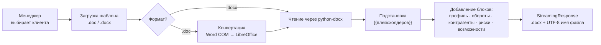
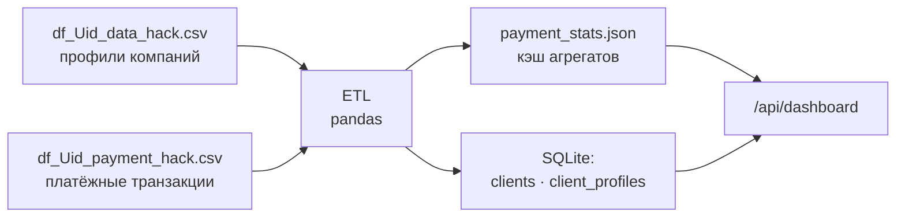
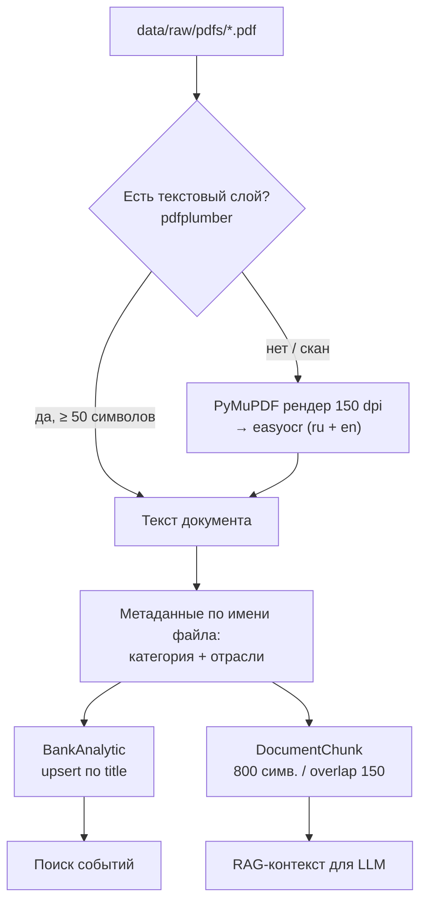
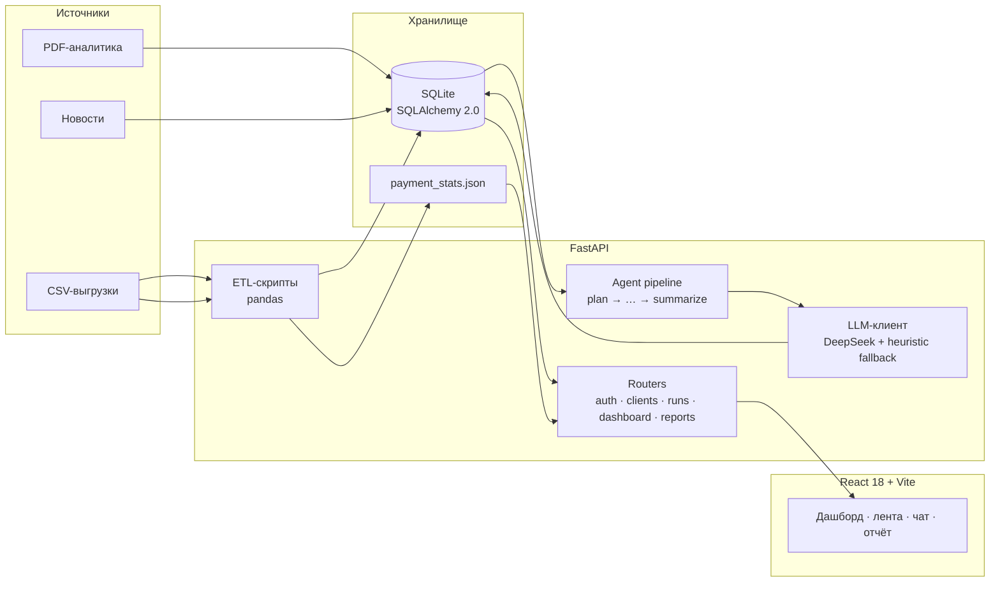

<div align="center">

# 🏦 Alfa Insight MVP

### AI-аналитик для руководителей крупного бизнеса

Персонализированная интерпретация новостей и аналитики Альфа-Банка по каждому клиенту:
многошаговый агентный пайплайн, риск/возможность с механизмом влияния, трассировка каждого шага
и выгрузка готового отчёта в DOCX по корпоративному шаблону.


</div>

---

## 📑 Содержание

- [Что это](#-что-это)
- [Киллер-фичи](#-киллер-фичи)
  - [1. Скачивание документов — DOCX по вашему шаблону](#1-📄-скачивание-документов--docx-по-вашему-шаблону)
  - [2. Парсинг CSV — реальные данные заказчика](#2-📊-парсинг-csv--реальные-данные-заказчика)
  - [3. Парсинг PDF + AI-OCR + RAG](#3-🧠-парсинг-pdf--ai-ocr--rag)
- [Архитектура](#-архитектура)
- [Пайплайн агента](#-пайплайн-агента)
- [Стек](#-стек)
- [Быстрый старт](#-быстрый-старт)
- [Переменные окружения](#-переменные-окружения)
- [API](#-api)
- [Роли и доступ](#-роли-и-доступ)
- [Скрипты](#-скрипты)
- [Структура проекта](#-структура-проекта)
- [Ограничения](#-ограничения)
- [Безопасность](#-безопасность)

---

## 🎯 Что это

Банк знает о клиенте много: отрасль, выручку, продукты, контрагентов, платежные обороты.
Банк также обладает сильной аналитикой — PDF-отчёты, макрообзоры, отраслевые исследования.
Проблема в том, что между этими двумя мирами нет моста.

**Alfa Insight MVP** строит этот мост. По каждому клиенту система:

1. собирает бизнес-контекст из реальных выгрузок (CSV) и базы знаний (PDF);
2. находит релевантные события — новости и аналитические документы;
3. ранжирует их с приоритетом «риск / возможность»;
4. объясняет **механизм влияния именно на этого клиента** и предлагает конкретные действия;
5. отдаёт всё в дашборд и выгружает в DOCX-отчёт по шаблону банка.

> Ключевой принцип: **никаких выдуманных цифр**. Все суммы, обороты и контрагенты берутся
> из БД и кэша агрегатов; LLM только интерпретирует, а при недоступности — срабатывает
> детерминированный heuristic-фоллбэк.

---

## ⚡ Киллер-фичи

### 1. 📄 Скачивание документов — DOCX по вашему шаблону

Менеджер загружает **свой** корпоративный шаблон, система возвращает готовый файл с данными клиента.



**Что умеет:**

| Возможность | Детали |
|---|---|
| Оба формата Word | `.docx` читается напрямую, `.doc` конвертируется автоматически |
| Двухступенчатая конвертация | Microsoft Word (COM, с отключёнными макросами) → LibreOffice headless → понятная ошибка |
| Подстановка в шаблон | `{{report_title}}`, `{{company_name}}`, `{{industry}}`, `{{revenue}}`, `{{region}}`, `{{products}}`, `{{date}}`, `{{incoming}}`, `{{outgoing}}`, `{{counterparties}}`, `{{risks_count}}`, `{{opportunities_count}}` |
| Форматирование «по-банковски» | Суммы → `1,2 млрд ₽` / `млн ₽` / `тыс ₽`, кириллическая типографика |
| Пустой шаблон не ломает отчёт | Если в шаблоне нет контента — блоки просто дописываются в конец |
| Кириллица в имени файла | RFC 5987 (`filename*=UTF-8''...`) + санитайзинг запрещённых символов |
| Защита от перегруза | Лимит 15 МБ, валидация расширения, аккуратные HTTP-ошибки |

Эндпоинт: `POST /api/companies/{company_id}/report` → `application/vnd.openxmlformats-officedocument.wordprocessingml.document`
Реализация: `app/routers/reports.py`, `app/report_builder.py`, `app/doc_converter.py`.

---

### 2. 📊 Парсинг CSV — реальные данные заказчика

Обезличенные выгрузки клиентов и платежей превращаются в профили и граф контрагентов.



**Что умеет:**

- **Устойчивое чтение**: разделитель `;`, авто-детект кодировки (`utf-8` → `utf-8-sig` → `cp1251`), `on_bad_lines="skip"`, нормализация имён колонок.
- **Дедупликация** по `SYNTHETIC_U` — один клиент = одна запись.
- **Продуктовый профиль** из флагов `CL_PRODUCT_*_MARK`: РКО, гарантии, кредиты, лизинг, депозиты, зарплатный проект.
- **Бизнес-контекст**: `REVENUE_COMPANY`, `MAINOKVED_NAME`, `REGION`, `CITY`, `CL_TYPE`, `COMPANY_AGE_YEARS_GRADATION`, `NEGATIVEMARK`, `ECO_MARK_LABEL` → описание и риск-заметки.
- **Граф контрагентов** считается в pandas, а не запросами в цикле: `groupby(PAYER, BENEFICIARY)` → **топ-5 поставщиков и топ-5 покупателей** по сумме.
- **Кэш агрегатов** (`data/payment_stats.json`): входящие/исходящие обороты, число транзакций и уникальных контрагентов (`in`, `out`, `inTx`, `outTx`, `inCp`, `outCp`). Дашборд читает лёгкий JSON, а **не 38-мегабайтный CSV** на каждый запрос.

Реализация: `app/debug_ingest_csv.py` (полный ETL), `app/sync_metrics.py` (точечное обновление профилей и кэша), `app/metrics.py` (агрегаты без зависимости от FastAPI и ORM).

---

### 3. 🧠 Парсинг PDF + AI-OCR + RAG

Аналитика Альфа-Банка индексируется в базу знаний, из которой агент достаёт контекст.



**Что умеет:**

- **Двухрежимное извлечение текста**: сначала быстрый текстовый слой (`pdfplumber`), только для сканов включается OCR — не тратим минуты на то, что можно прочитать мгновенно.
- **AI-OCR** (`easyocr`, `ru` + `en`, `paragraph=True`) постранично, с прогрессом в консоли.
- **Стабильные ID источников**: `BankAnalytic` обновляется **по названию файла**, а не пересоздаётся — иначе `event_insights.source_id` начали бы указывать на чужие документы.
- **Нарезка под RAG**: чанки по 800 символов с перекрытием 150 — контекст не рвётся на границах.
- **Авто-категоризация** по имени файла: металлургия, драгоценные металлы, макроэкономика, финансовые рынки.
- **RAG-поиск** по чанкам, который подмешивается в промпт при интерпретации каждого события.

Реализация: `app/debug_ingest_pdf.py`, поиск — `app/routers/dashboard.py::_rag_snippets`, инструменты агента — `app/agent/tools.py::search_rag`.
Тяжёлые зависимости для PDF/OCR вынесены в `requirements-dev.txt` (easyocr тянет torch ~2.5 ГБ).

---

## 🏗 Архитектура



- **Backend**: FastAPI + SQLAlchemy 2.0 (typed `Mapped`), SQLite, Pydantic v2.
- **Агент**: 7 шагов, каждый пишется в `run_steps` (вход, выход, статус, длительность).
- **Безопасность агента**: whitelist инструментов + `ToolLog` на каждый вызов (параметры, разрешён/нет, причина).
- **LLM**: `LLM_PROVIDER=deepseek` — реальный вызов; `mock` — детерминированные эвристики (риск/возможность, действия, чат). Модель по ТЗ — **DeepSeek-V4.1-Flash**.
- **Frontend**: React 18 + Vite 6, прод-сборка раздаётся тем же FastAPI из `frontend/dist`.

---

## 🔄 Пайплайн агента

`app/agent/pipeline.py` — запуск через `POST /api/clients/{id}/analyze` (в фоне) или `python -m app.generate_insights`.

| # | Шаг | Что делает |
|---|---|---|
| 0 | `plan` | Формирует план: список шагов, лимиты `MAX_EVENTS_PER_RUN`, `MAX_RETRIES` |
| 1 | `load_context` | Профиль клиента + derived-сигналы (экспорт, пошлины, санкции, логистика, кадры) → поисковые запросы |
| 2 | `retrieve` | Поиск по PDF-аналитике, новостям и RAG-чанкам |
| 3 | `rank` | Скоринг релевантности + гарантия, что в ленте будет **минимум один риск и одна возможность** |
| 4 | `interpret` | LLM: риск/возможность, механизм влияния, затронутые направления, 2–4 конкретных действия, CTA |
| 5 | `self_check` | Повторная проверка/доработка ответа при необходимости |
| 6 | `summarize` | Сводка по клиенту, сохранение `analysis_runs` + `event_insights` |

Дашборд показывает **только последний запуск** клиента — в ленту не попадают устаревшие инсайты и дубли.

---

## 🧰 Стек

| Слой | Технологии |
|---|---|
| Backend | Python 3.11, FastAPI 0.115, Uvicorn, Pydantic 2 / pydantic-settings |
| Данные | SQLAlchemy 2.0, SQLite, pandas 2.2 |
| Auth | JWT (`python-jose`), bcrypt (`passlib`), RBAC |
| LLM | DeepSeek API (`httpx`) + детерминированный fallback |
| PDF / OCR | pdfplumber, PyMuPDF, easyocr, numpy, Pillow |
| Документы | python-docx, Word COM (`pywin32`), LibreOffice |
| Frontend | React 18, Vite 6, чистый CSS (адаптив до 600 px) |

---

## 🚀 Быстрый старт

### 1. Backend

```bash
git clone <repo-url> && cd AlphaBankService
python -m venv .venv
# Windows: .venv\Scripts\activate
source .venv/bin/activate

pip install -r requirements.txt          # ядро
pip install -r requirements-dev.txt      # + PDF/OCR (easyocr тянет torch ~2.5 ГБ)
```

### 2. Конфигурация

```bash
cp .env.example .env      # Windows: copy .env.example .env
# заполните DEEPSEEK_API_KEY или оставьте LLM_PROVIDER=mock
```

### 3. Загрузка данных

```bash
python -m app.debug_ingest_csv    # CSV → клиенты, профили, граф контрагентов
python -m app.debug_ingest_pdf    # PDF → аналитика + чанки для RAG
python -m app.sync_metrics        # обновить профили и пересобрать payment_stats.json
python -m app.check_db            # проверить, что всё загрузилось
```

### 4. Генерация инсайтов

```bash
python -m app.generate_insights   # первый прогон по клиентам
python -m app.refresh_insights    # перегенерация после переиндексации PDF
```

### 5. Запуск API

```bash
uvicorn app.main:app --reload
# Swagger: http://localhost:8000/docs
# Health:  http://localhost:8000/health
```

### 6. Frontend

```bash
cd frontend
npm install
npm run dev        # dev-сервер + прокси /api → :8000
npm run build      # прод-сборка в frontend/dist, её раздаёт FastAPI на "/"
```

### 7. Деплой (важно про статику)

`frontend/dist/` в `.gitignore`, поэтому на сервере UI нужно собрать **после** `git pull`:

```bash
cd frontend && npm ci && npm run build && cd ..
# проверить, что на месте и index.html, и хэшированные файлы:
ls frontend/dist/index.html frontend/dist/assets/
uvicorn app.main:app --host 0.0.0.0 --port 8080
```

Что делает `app/main.py`:

- статику ищет от корня проекта (`Path(__file__).parent.parent`), а не от текущей рабочей
  директории — запуск uvicorn из другого каталога больше не ломает `/assets`;
- монтирует `/assets` и `/icons` **безусловно**, поэтому пересборка UI подхватывается
  без перезапуска сервера и без «404 на всё»;
- отдаёт `index.html` с `Cache-Control: no-store`, а хэшированные файлы сборки — с
  `immutable`: браузер/CDN не хранит старый HTML со ссылками на удалённые `/assets/*`;
- на старте проверяет сборку и пишет в лог, каких файлов из `index.html` не хватает:
  `Сборка frontend неполная/устаревшая: index.html ссылается на отсутствующие файлы ...`;
- `GET /health` показывает `"frontend_built": true|false` — быстрая проверка на хосте.

Если в прод-логах `GET /assets/*.js 404`, а `/` отдаётся — значит на сервере нет
`frontend/dist/assets` (не собрано / не задеплоено). Лечится пересборкой выше;
после деплоя сбросьте кэш `index.html` в CDN (Cloudflare: Purge Everything или
by URL `/`).

---

## ⚙️ Переменные окружения

| Переменная | По умолчанию | Назначение |
|---|---|---|
| `APP_NAME` | `Alfa Insight MVP` | Название приложения |
| `DATABASE_URL` | `sqlite:///./data/app.db` | Строка подключения к БД |
| `JWT_SECRET` | `change-me-in-production` | **Обязательно заменить в проде** |
| `JWT_ALG` / `JWT_EXPIRE_MINUTES` | `HS256` / `480` | Параметры токена |
| `LLM_PROVIDER` | `mock` | `deepseek` — реальная модель, `mock` — эвристики для офлайн-демо |
| `LLM_MODEL` | `DeepSeek-V4.1-Flash` | Модель по ТЗ |
| `DEEPSEEK_API_KEY` | — | Ключ DeepSeek |
| `DEEPSEEK_BASE_URL` | `https://api.deepseek.com/v1` | Базовый URL API |
| `MAX_EVENTS_PER_RUN` | `5` | Сколько событий попадает в ленту |
| `MAX_RETRIES` | `1` | Повторы LLM/шагов |
| `TOOL_TIMEOUT_SECONDS` | `10` | Таймаут инструментов |
| `VITE_API_BASE_URL` | `http://localhost:8000` | Адрес бэкенда для React |

---

## 🔌 API

Базовый префикс — `/api`. Полная схема — `/docs`.

| Метод | Путь | Роли | Описание |
|---|---|---|---|
| `POST` | `/api/auth/login` | — | OAuth2 form → JWT + роль |
| `GET` | `/api/auth/me` | любая | Текущий пользователь |
| `GET` | `/api/clients?page=&size=` | любая | Клиенты постранично |
| `GET` | `/api/clients/{id}` | любая | Карточка клиента |
| `POST` | `/api/clients/{id}/analyze` | analyst / admin | Запуск AI-анализа (фон) → `run_id` |
| `GET` | `/api/runs` | любая | Последние запуски |
| `GET` | `/api/runs/{id}` | любая | Детали запуска + шаги |
| `GET` | `/api/runs/{id}/tools` | analyst / admin | Журнал вызовов инструментов |
| `GET` | `/api/news` | любая | Новости + PDF-аналитика единой лентой |
| `GET` | `/api/analytics` | любая | Аналитические материалы |
| `GET` | `/api/dashboard?companyId=` | — | Всё для React-дашборда одним запросом |
| `POST` | `/api/news/{id}/chat` | — | AI-чат по конкретному событию |
| `POST` | `/api/companies/{id}/report` | — | DOCX-отчёт по шаблону (multipart) |
| `GET` | `/health` | — | Статус, провайдер и модель LLM |

Пример выгрузки отчёта:

```bash
curl -X POST "http://localhost:8000/api/companies/1/report" \
  -F "template=@data/report_template_example.docx" \
  -F "title=Отчёт по компании" \
  -o report.docx
```

---

## 👥 Роли и доступ

| Роль | Возможности |
|---|---|
| `viewer` | Просмотр клиентов, ленты, запусков |
| `analyst` | + запуск анализа, журнал инструментов |
| `admin` | + полный журнал вызовов инструментов |

Тестовые учётные записи создаются `app/seed.py` при первом старте:
`admin/admin123`, `analyst/analyst123`, `viewer/viewer123`
(**только для локальной разработки — смените перед демонстрацией заказчику**).

---

## 🛠 Скрипты

| Команда | Что делает |
|---|---|
| `python -m app.debug_ingest_csv` | Полный ETL CSV: клиенты, профили, граф контрагентов, кэш агрегатов |
| `python -m app.debug_ingest_pdf` | Индексация PDF: текстовый слой → OCR, чанки, метаданные |
| `python -m app.sync_metrics` | Обновить справочные метрики и `payment_stats.json` без потери аналитики |
| `python -m app.generate_insights` | Первый прогон пайплайна по клиентам |
| `python -m app.refresh_insights` | Перегенерация инсайтов после переиндексации источников |
| `python -m app.check_db` | Дашборд-статистика по БД в консоли |
| `python -m app.debug_clear_news` | Очистить новости, оставить только PDF-аналитику |
| `cd frontend && npm run build` | Прод-сборка UI в `frontend/dist` |

---

## 🗂 Структура проекта

```
AlphaBankService/
├── app/
│   ├── agent/                 # агентный пайплайн
│   │   ├── pipeline.py        # 7 шагов, RunStep-трассировка
│   │   ├── ranking.py         # скоринг релевантности
│   │   └── tools.py           # whitelist инструментов + ToolLog
│   ├── llm/
│   │   ├── client.py          # DeepSeek + fallback
│   │   ├── heuristics.py      # детерминированные правила
│   │   ├── text.py            # чистка OCR, нормализация текста
│   │   └── document_overrides.py
│   ├── routers/               # auth · clients · news · runs · dashboard · reports
│   ├── static/                # legacy UI без сборки
│   ├── config.py              # pydantic-settings
│   ├── models.py              # ORM: клиенты, события, прогоны, чанки, логи
│   ├── metrics.py             # агрегаты платежей → JSON-кэш
│   ├── doc_converter.py       # .doc → .docx (Word / LibreOffice)
│   ├── report_builder.py      # сборка DOCX по шаблону
│   ├── debug_ingest_csv.py    # ETL выгрузок заказчика
│   ├── debug_ingest_pdf.py    # PDF + OCR + чанки
│   ├── sync_metrics.py        # синхронизация метрик
│   ├── generate_insights.py   # пакетный прогон
│   └── main.py                # точка входа FastAPI
├── frontend/                  # React 18 + Vite 6
│   ├── src/App.jsx            # дашборд, лента, чат, модалка отчёта
│   └── src/api/client.js      # API-клиент
├── data/
│   ├── raw/                   # исходные CSV и PDF
│   └── payment_stats.json     # кэш платёжных агрегатов
├── requirements.txt           # ядро
├── requirements-dev.txt       # PDF / OCR
└── .env.example
```

---

## ⚠️ Ограничения

- **SQLite** — осознанный выбор для MVP; для прод-нагрузки нужен PostgreSQL и фоновые воркеры (сейчас пайплайн работает в `BackgroundTasks`).
- **Поиск по чанкам лексический**, без векторных эмбеддингов — прозрачно и быстро, но уступает semantic search на больших корпусах.
- **Эндпоинты дашборда и чата** (`/api/dashboard`, `/api/news/{id}/chat`) сейчас не требуют JWT — их стоит закрыть перед публичным развёртыванием.
- **OCR зависит от железа**: на CPU обработка сканов занимает минуты; `easyocr` ~2.5 ГБ зависимостей.
- **`.doc` → `.docx`** нужен Microsoft Word или LibreOffice; иначе пользователю возвращается понятная инструкция сохранить шаблон в DOCX.
- Инсайты привязаны к `source_id` документов: **после переиндексации PDF запускайте `python -m app.refresh_insights`**.

---

## 🔐 Безопасность

- `.env` исключён из git — секреты не попадают в репозиторий. Если ключ когда-либо коммитился, **отзовите и перевыпустите его**.
- Перед демонстрацией смените `JWT_SECRET` и пароли демо-пользователей.
- Агент работает только с whitelisted инструментами; параметры санитизируются (пароли/токены/секреты вырезаются из журнала).
- Макросы в загружаемых шаблонах отключены (`AutomationSecurity = 3`), файлы читаются в режиме `ReadOnly`.
- Лимиты: 15 МБ на шаблон, ≤ 20 результатов на инструмент, ≤ 200 символов на запрос.

---

## 📚 Третьи стороны

Перечень сторонних компонентов и лицензий — в [`THIRD_PARTY_NOTICES.md`](THIRD_PARTY_NOTICES.md).

<div align="center">

**Alfa Insight MVP** · MVP для хакатона · 2026

</div>